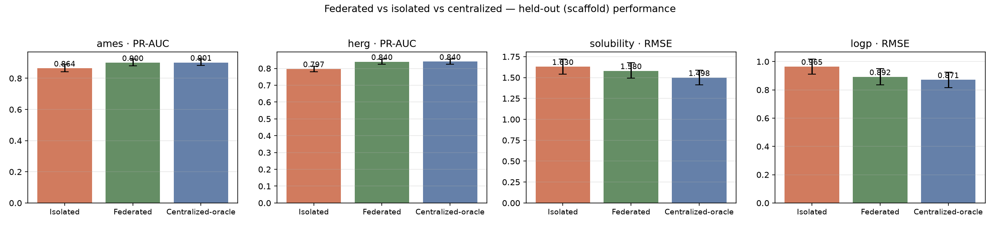
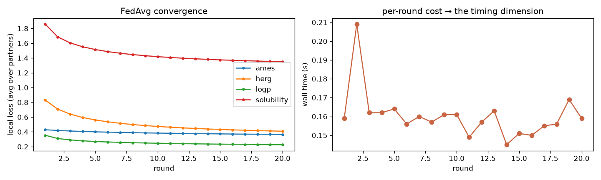
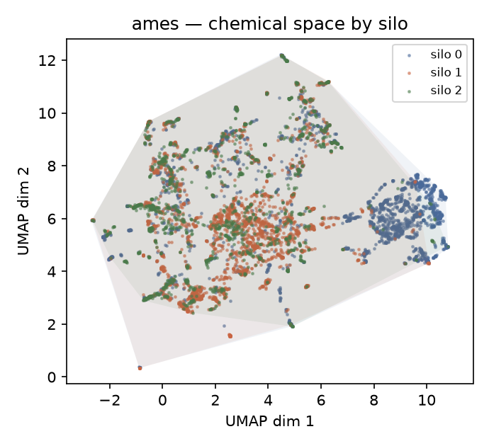
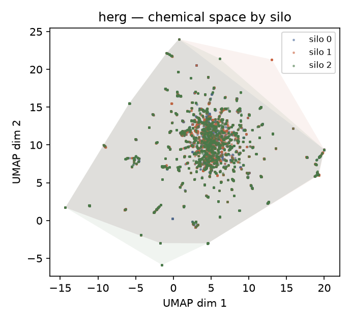
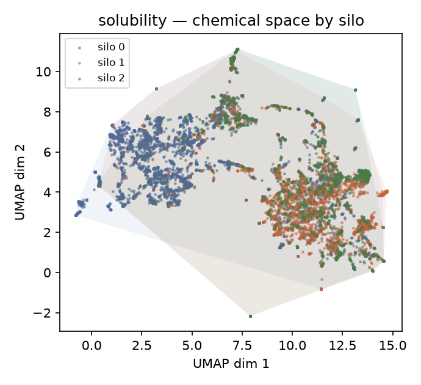
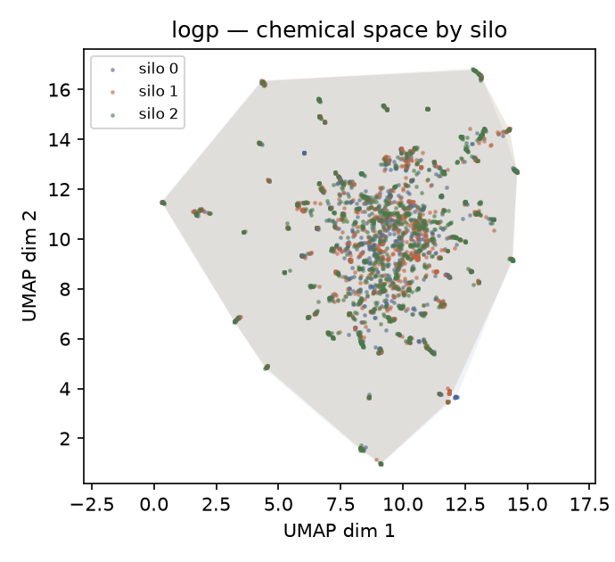

# Federated learning for small-molecule property prediction

**curiosity_001** — a self-contained study comparing cross-silo federated learning
(FL) against classical training approaches for a cheminformatics problem:
predicting ADMET / toxicity-related properties from molecular structure.

The driving question isn't just *"can I train a model federated?"* — it's
*"when does FL actually win, where does it lose, and what makes it harder than
ordinary training?"* Everything here is public data and standard tooling, so the
whole thing is reproducible in a weekend on a laptop.

---

## Why this is an interesting question

Drug-discovery ADMET data is fragmented: each organization holds chemistry that
others cannot, by contract, ever see. Classical modelling assumes you can pool
everyone's data into one table. Federated learning rejects that assumption —
the data stays where it is, and only model updates travel. That trade (privacy
and breadth vs. engineering and training cost) is what this project measures.

## The comparison

Three training regimes, same public datasets:

| Regime | What happens to the data | What you get back |
|---|---|---|
| **Isolated** | Each partner trains only on its own silo | The status-quo baseline — strong on familiar chemistry, blind to everyone else's |
| **Federated (FL)** | Local training, only weight updates shared, FedAvg aggregation | Numbers indicate privacy-preserved breadth — reaches chemistry no partner could see alone |
| **Centralized-oracle** | All data pooled into one table | The theoretical upper bound — best possible quality, privacy impossible |

Endpoints are split evenly between task types:
- **Binary classification:** Ames, hERG (mutagenicity / hERG-cardiotoxicity)
- **Continuous regression:** Solubility (AqSolDB — aqueous logS), LogP (lipophilicity)

So the pipeline is exercised on both task types, two endpoints each.

## Models

**Primary — fingerprint + linear model.** ECFP/Morgan fingerprints feed
logistic regression (binary endpoints) and linear regression (regression
endpoints). Logistic regression is the canonical federated learner — FedAvg was
demonstrated on it — so this validates that federated learning works with
*classical* ML, not just neural networks. It trains in seconds, so the whole
regime comparison iterates fast.

**Optional stretch — ChemProp (GNN).** Kept out of the core scope for now, but
the harness is designed so a graph neural network can drop in later on a reduced
endpoint set (one binary + one regression) to test whether the FL conclusion
depends on model class. Add if time allows.

## Method

### Pipeline

```
                 Public ADMET data (Ames · hERG · Solubility · LogP)
                                   │
                                   ▼  scaffold split → never-touched held-out set
                         split remaining into 3–4 non-IID "partner" silos
                                    (distinct chemistry per site)
      ┌────────────┐   ┌────────────┐   ┌────────────┐        ┌────────┐
      │ Partner  A │   │ Partner  B │   │ Partner  C │  ...   │ Server │
      │ local QC ──┼──►│ local QC ──┼──►│ local QC   │        │ FedAvg │
      │ train model│   │ train model│   │ train model│◄───────┤(no data)│
      │  ↑ weights │   │  ↑ weights │   │  ↑ weights │        │        │
      └─────┬──────┘   └─────┬──────┘   └─────┬──────┘        └────────┘
            └─── only weight updates travel — raw molecules never leave
                                   │
                                   ▼
        Benchmark: isolated  vs  federated  vs  centralized-oracle
                                   │
                                   ▼
                Privacy probe: can we tell which molecules were
                used in training? (membership inference)
```

### What we measure

| Dimension | How | Realistic expectation |
|---|---|---|
| **Chemical-space coverage** | Accuracy vs. distance to nearest training molecule (Tanimoto), on off-silo scaffolds | FL broadens the applicability domain beyond isolated |
| **Performance** | PR-AUC / RMSE per endpoint, with confidence intervals | FL ≈ centralized > isolated, most on sparse endpoints |
| **Training time** | Wall-clock of full run; client compute vs. communication | FL is slower — the honest cost of privacy |

The thesis, stated plainly: *FL trades training wall-time for
privacy-preserving breadth* — it reaches chemistry a single partner could never
have access to.

---

## Results

All figures are generated fresh by the pipeline scripts into `results/` and
committed here so they render on GitHub.

### Three-regime performance (held-out, scaffold-split test set)

| Endpoint | Task | Isolated | Federated | Centralized-oracle |
|---|---|---|---|---|
| Ames | PR-AUC | 0.864 [0.841–0.890] | 0.900 [0.881–0.922] | **0.901** [0.883–0.923] |
| hERG | PR-AUC | 0.797 [0.780–0.814] | 0.840 [0.825–0.854] | **0.840** [0.826–0.855] |
| LogP | RMSE | 0.965 [0.912–1.017] | 0.892 [0.836–0.950] | **0.871** [0.817–0.926] |
| Solubility | RMSE | 1.630 [1.541–1.720] | 1.580 [1.491–1.676] | **1.498** [1.415–1.589] |

On every endpoint the ordering is exactly the expected one —
**centralized ≥ federated ≥ isolated** (for RMSE, lower is better, so
centralized ≤ federated ≤ isolated) — and federated realistically approaches
the centralized-oracle while no partner ever saw another's chemistry.



### Federated convergence

Per-round ensemble loss for all four endpoints over the 20 FedAvg rounds —
federated classification (Ames, hERG) converges smoothly with the round-based
learning-rate schedule (no oscillation), and regression (LogP, Solubility) anneals
monotonically:



### Chemical-space coverage per silo

UMAP embedding of each endpoint's pooled fingerprint space, coloured by which
partner's silo each molecule belongs to, with per-silo convex-hull overlays.
Scaffolds are split scaffold-disjoint across silos (no scaffold appears in two
silos), but distributed evenly rather than clustered by chemistry, so silos
interleave across the whole space instead of owning segregated regions.

| Endpoint | p0 share | p1 share | p2 share |
|---|---|---|---|
| Ames | 99.6% | 95.6% | 87.1% |
| hERG | 85.0% | 95.6% | 91.8% |
| Solubility | 88.7% | 88.5% | 86.7% |
| LogP | 98.9% | 98.8% | 98.9% |

(Share = silo hull area ÷ union hull area in UMAP space — a crude visual aid,
not a rigorous diversity metric.)






> Full machine-readable tables: `results/metrics/regime_*.json`,
> `results/umap_coverage.md`, `results/benchmark_summary.md`.

---

## Study-project disclaimer

This is a **personal study / learning project** — a labelled *curiosity*
repository rather than a production-ready system. It is deliberately a
scientific exercise on public data: it measures the *direction* of the
FL-vs-baseline comparison, not deployable, shield-ready performance. Several
sophistications a real-life project would apply are **out of scope here**:

- **No cross-validation.** Endpoints use a single scaffold-based held-out split
  with bootstrap CIs; there is no repeated k-fold, no external validation
  cohort, and no held-out *partner* (every partner appears in training).
- **One fixed training recipe.** A single learning-rate schedule, one
  regularisation value, and one seed per endpoint — no hyperparameter sweep.
- **A single model class** (ECFP + linear heads). No deep architectures, no
  ensembling, no data augmentation.
- **Simulated federation.** "Partners" are partitions of one public dataset;
  there is no real multi-party deployment, no communication bandwidth/straggler
  modelling, no production DP accounting beyond a membership-inference probe.

The results are reproducible and internally consistent, but numbers here should
be read as *signals and methodology*, not as benchmark-grade scores.

---

## Repository layout

```
src/fedlearn/     importable package (data, splitting, validators, models, FL, eval, privacy)
notebooks/        marimo notebooks — the analysis entry point
scripts/          small CLI tools (dataset download, run FL)
data/             datasets (git-ignored)
results/          figures + model artifacts (git-ignored)
docs/             project notes (git-ignored)
```

## Getting started

Python 3.12 is pinned via `uv`; all dependencies live in a project-local
virtualenv.

```bash
bash scripts/setup_env.sh         # uv sync + dependency/version check (logged)
uv run marimo edit notebooks      # launch the analysis environment
```

The full walkthrough — stage-by-stage commands, expected log lines,
troubleshooting — lives in **`docs/RUNBOOK.md`**. Pipeline stages map to
`scripts/` one-to-one:

| Stage | Script | Produces |
|---|---|---|
| 1 · data & silos | `download_data.py` | raw CSVs, split parquets, silos |
| 2 · validation & QC | `run_validation.py` | verdicts, QC report, overlap table, `pytest` |
| 3a · baselines | `run_models.py` | isolated + centralized metrics |
| 3b · federated loop | `run_federated.py` | federated weights + per-round history |
| 4 · benchmark | `benchmark.py` | money plot, coverage table, summary |
| 5 · privacy audit | `privacy_probe.py` | membership-inference before/after DP |

```bash
bash scripts/run_all.sh          # everything, in order, stop on first error
```

> Notebook tooling: [marimo](https://marimo.io) — reactive Python notebooks,
> tracked as plain `.py` files so they diff cleanly in git.

## License

MIT. This is a learning project on public data — nothing here is proprietary.